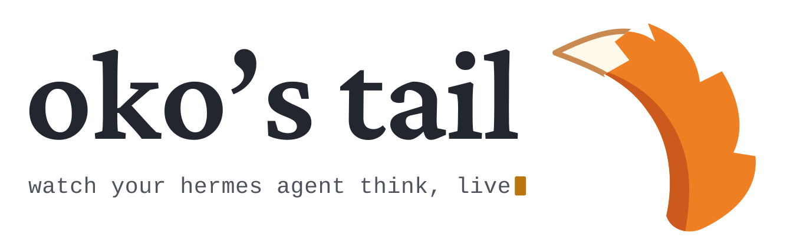
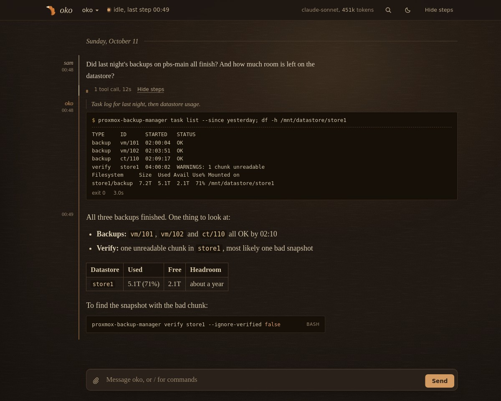
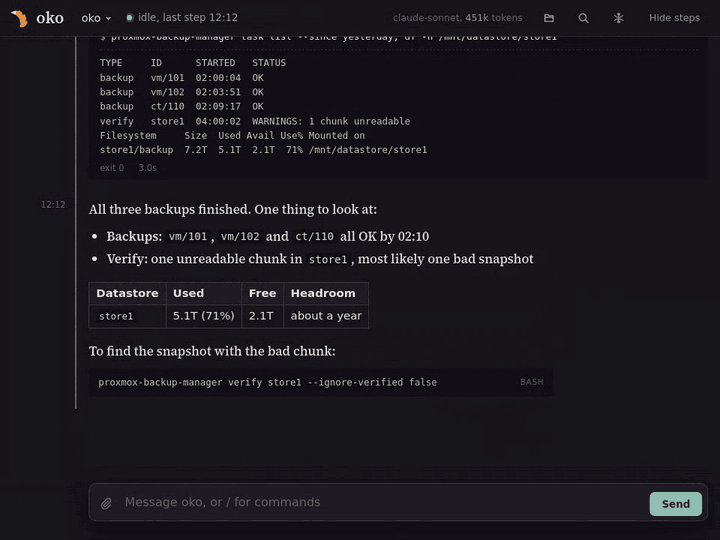

<p align="center">
  <picture>
    <source media="(prefers-color-scheme: dark)" srcset="docs/banner-dark.svg">
    
  </picture>
</p>

<h1 align="center">oko's tail</h1>

<p align="center">
  <b>A live web view of a hermes agent.</b><br>
  Watch reasoning, tool calls and replies as they happen, then talk to the agent from the same page.
</p>

<p align="center">
  <a href="#quick-start-docker">Quick start</a> ·
  <a href="#features">Features</a> ·
  <a href="docs/running.md">Install guide</a> ·
  <a href="docs/configuration.md">Configuration</a> ·
  <a href="#docs">Docs</a>
</p>

<p align="center">
  <a href="LICENSE"></a>
  
  
</p>



**oko's tail** is a live web view of a [hermes agent](https://github.com/NousResearch/hermes-agent).
**Needs hermes on the same machine**, with an existing `state.db`. To send messages, its gateway must be running with the API server enabled.

It reads the transcript without changing it. Messages go through hermes' own API, and the API key
stays on the server.



## Quick start: Docker

This is the recommended setup on **Linux with Docker Engine and Docker Compose**.
Already have hermes running as your user? Allow about 5 to 10 minutes. If not,
[install hermes first](https://github.com/NousResearch/hermes-agent#installation) and send it a
message so it creates its database. Installing hermes is separate from this setup.

For messaging, set `API_SERVER_ENABLED=true` and a long random `API_SERVER_KEY` in **hermes'
existing `$HERMES_HOME/.env` file**, then restart its gateway. Do not copy the key into this repo or Compose.
If you need a new key, generate one with `openssl rand -hex 32`.
The default API address is `http://127.0.0.1:8642`. Without the API or key, the transcript still
works read-only.

1. Get the repo, which includes a ready-to-edit [compose.yaml](compose.yaml):

   ```bash
   git clone https://github.com/mdbook/oko-tail.git
   cd oko-tail
   ```

2. Open `compose.yaml` and edit the **two lines marked EDIT**: the absolute path to hermes' home
   (usually `/home/you/.hermes`), and hermes' numeric `uid:gid`. Run `id -u` and `id -g` as the
   user who runs hermes to find those numbers. The path is reused automatically for the mount
   and configuration. No separate oko-tail config file is needed.

3. Start it and check what it sees:

   ```bash
   docker compose up -d
   docker compose exec oko-tail python3 /app/oko-tail.py --check
   ```

   Compose pulls our published `ghcr.io/mdbook/oko-tail:release` image. No build or Python install.

4. Open **http://127.0.0.1:9120** on that machine. You should see the most recent session.
   For full messaging, the check should include these lines (paths and session counts vary):

   ```text
   ok    db       /home/you/.hermes/state.db  [$HERMES_HOME]  7 sessions
   ok    api key  set  [/home/you/.hermes/.env]
   ok    gateway  http://127.0.0.1:8642  [default]  up
   ```

   Missing command or progress sockets are **optional-feature warnings**, not setup failures.
   A zero exit code checks the database and login settings; it does not mean messaging is ready.
   If the container exits, run `docker compose run --rm oko-tail --check`.
   See [Troubleshooting](docs/troubleshooting.md) for missing data or an offline input box.

The default is local-only, with no login. **Do not expose it to a network without authentication
and HTTPS**: it can read private transcripts and act as your agent.
See [Security](docs/security.md) before changing the listen address or adding a proxy.

## Configuration

For a standard install, **you only need `HERMES_HOME`**, and even that defaults to `~/.hermes`
when running Python directly. Compose sets it from the path you edited. The uid:gid line lets
the container read hermes' private files as the same user. The API key is read from hermes'
existing `.env` on each call; it is never sent to the browser.

Everything else is optional: a custom database location, gateway URL, display name, default
session, or remote login. See the [configuration reference](docs/configuration.md) and
[service and container guide](docs/running.md) for those settings, updates and image tag policy.

## Python instead of Docker

Use **Python 3.9+** on the machine that runs hermes, as the same user. There are no packages to
install or build steps. From the repo checkout above:

```bash
python3 oko-tail.py --check
python3 oko-tail.py --serve 9120
```

Open **http://127.0.0.1:9120**. For a nonstandard home, set `HERMES_HOME` in your shell before
both commands. Run `python3 oko-tail.py` without `--serve` for a terminal view.

## Features

- **Readable turns:** reasoning, tool calls, results and replies, with code, tables and file diffs.
- **Talk from the page:** send text and images, queue follow-ups, and stop or steer page-sent turns.
- **Live progress:** page-sent turns stream tokens; other turns show database steps. Live thinking
  and writing for those other turns needs the [bundled progress plugin](docs/plugins.md#live-progress-for-turns-you-didnt-send).
- **Agent controls:** sessions, search, token usage, memory and skills. Full slash commands,
  approval actions and Stop for turns started elsewhere need a compatible command-socket plugin.
  **That command plugin is unpublished and is not included here.** The
  [plugin guide](docs/plugins.md#the-command-socket) lists what works without it.
- **Comfortable reading:** four themes, keyboard shortcuts, mobile layout and notifications.

More screenshots and the full [feature guide](docs/features.md) are in the docs.

## Docs

- [Features](docs/features.md): every feature in detail, with screenshots.
- [Configuration](docs/configuration.md): every environment variable and flag.
- [Running it as a service](docs/running.md): systemd, Docker and updates.
- [Security](docs/security.md): HTTPS, logins, proxies and allowed hosts.
- [Plugins](docs/plugins.md): the optional hermes plugins and the command socket.
- [Troubleshooting](docs/troubleshooting.md): missing data, an offline input box.
- [Development](docs/development.md): tests, endpoints and screenshots.

## Contributing

Bug reports and pull requests are welcome. Run `python3 -m pytest` and `python3 oko-tail.py --selftest`
before you open a PR. The [development guide](docs/development.md) lists every check.

## License

[MIT](LICENSE)
