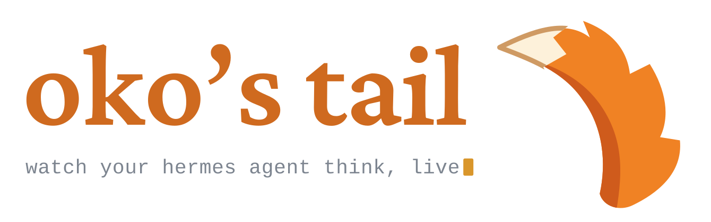
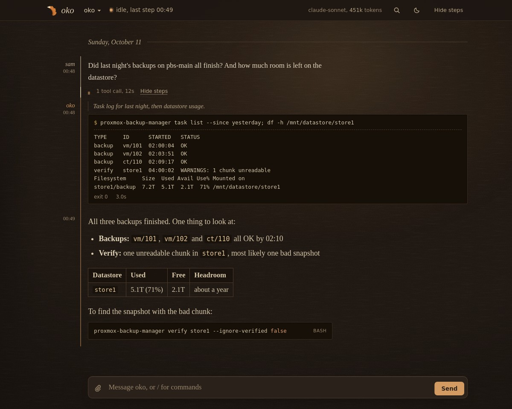
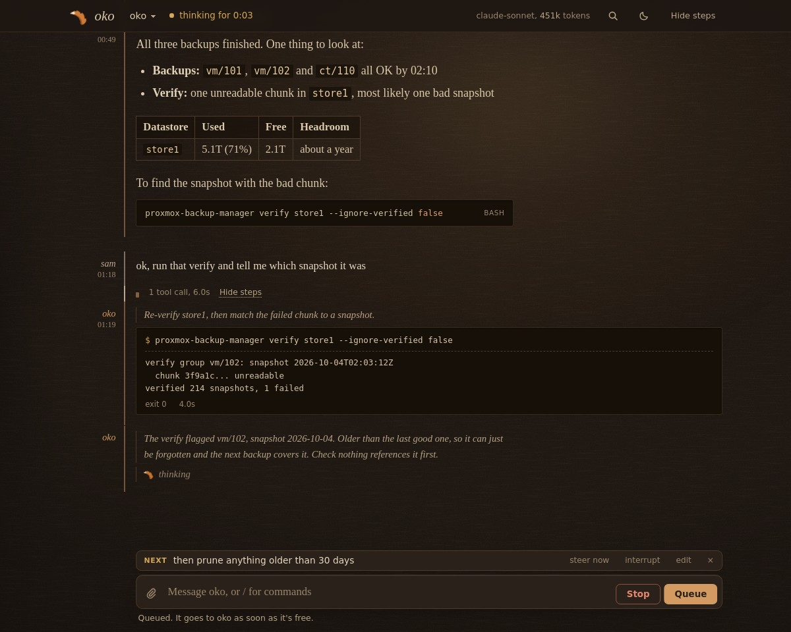
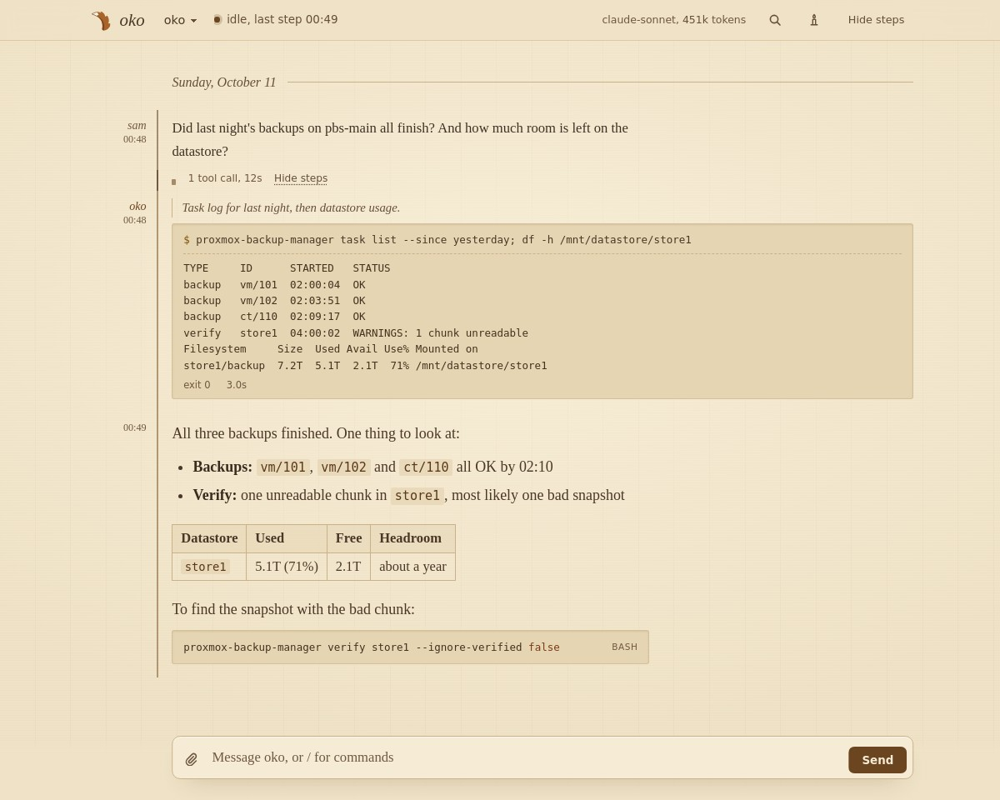
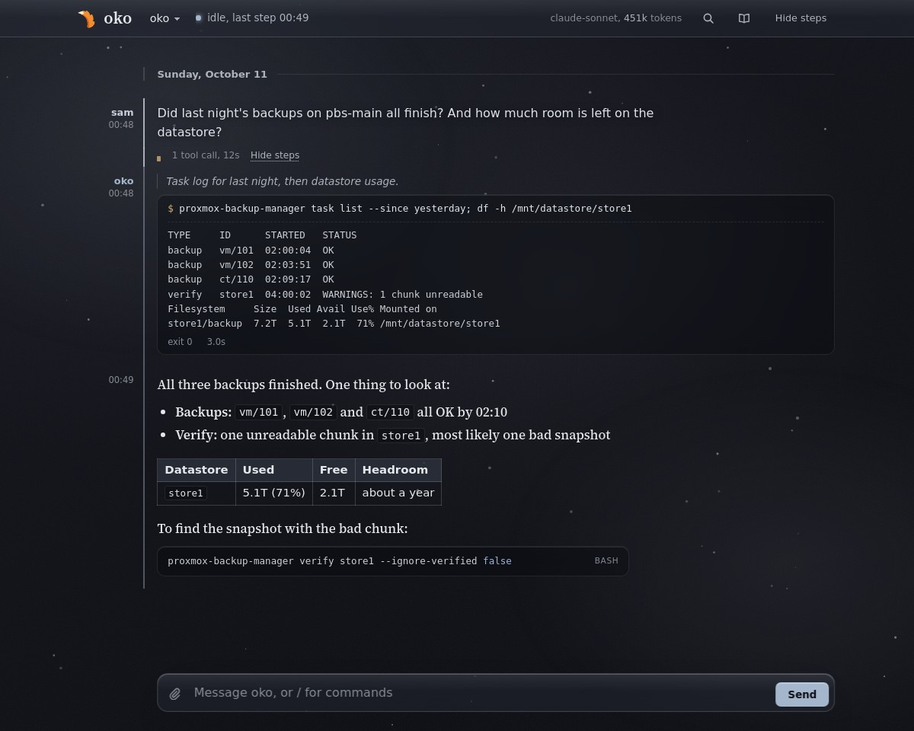
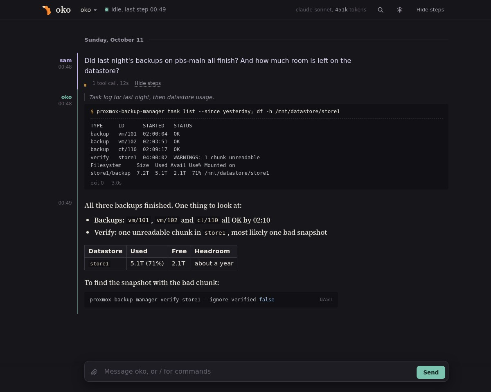

<p align="center">
  <picture>
    <source media="(prefers-color-scheme: dark)" srcset="docs/banner-dark.svg">
    <source media="(prefers-color-scheme: light)" srcset="docs/banner-light.svg">
    
  </picture>
</p>

**oko's tail** is a live web view of a [hermes](https://github.com/NousResearch/hermes-agent) agent.
You see each step of a turn as the agent takes it: its reasoning, every tool call and result, and the
final reply. You can also work with the agent from the same page: send messages and images, queue
follow-ups while it's busy, stop or steer a running turn, and run any slash command.

I built it to watch *oko*, my own hermes agent, and the name stuck. *Oko* means "eye" in several
languages, and a tail is both what you follow (`tail -f`) and what trails along behind.

- **Small.** One Python file and a few static web files. Standard library only: nothing to
  `pip install`, no build step.
- **Read-only on your data.** It opens hermes' `state.db` with `?mode=ro`. The only write path is the
  gateway's own session API, the same one every hermes client uses to start a turn.
- **Your API key stays where it is.** It reads `API_SERVER_KEY` from hermes' `.env` on each call and
  never copies, logs or sends it to the browser.

## Features



- **A transcript organized by turn.** Your message, the agent's steps folded underneath, then its
  reply. Tool output renders as a terminal, JSON as tables, and markdown with syntax-highlighted code.
- **Live progress.** Turns sent from the page stream token by token: reasoning, reply text and the
  current tool. Turns started anywhere else (a chat platform, cron, the CLI) appear step by step,
  with a status line showing whether the agent is waiting on the model or running a tool.
- **An activity indicator in the logo.** The fox tail dozes while waiting on the model, sways while
  thinking, wags during tool calls, flicks while writing and curls up while the context compacts.
- **A message queue.** Anything you send while the agent is busy waits above the input box. You can
  edit or remove it, *steer now* to add it to the running turn, or *interrupt* to stop the turn and
  send it immediately. Queued messages survive a reload and go out one at a time.
- **Stop any turn.** Stop (or `Esc` `Esc`) uses the agent's own `/stop`, so it works on any turn in
  the main session, wherever it started. Without the [command socket](#the-command-socket), it works
  on turns sent from the page.
- **A capable input box.** Drafts survive a reload, ↑/↓ recall earlier messages, images can be pasted,
  dropped or attached, and slash commands and skills autocomplete.
- **Scrolling that stays out of your way.** The view follows new steps only while you're at the
  bottom. Scroll up to read and it holds its place, with an "N new steps below" button to jump back.
- **Copy buttons** on replies, reasoning, tool calls and code blocks.
- **A token panel** (click the usage line, or press `t`): how full the context window is and what's
  using it (from the agent's own `/context`), the largest messages in context (click one to jump to
  it), lifetime totals and cost, and one-click model switching for the session.
- **Navigation and notifications.** A session switcher, search across the whole session, compaction
  markers, labels on failed turns, and a desktop notification when a reply lands.
- **Four themes**, cycled with `f` and remembered per browser: **shelf at night** (the default),
  **shelf** (tan paper and a Bookerly-style serif, set like an e-reader), **frost** (frosted glass
  with falling snow, light or dark to match your system) and the original dark theme.
- **Keyboard shortcuts** for everything: `j`/`k` between turns, `s` steps, `/` search, `c` compose,
  `f` theme, `t` tokens, `g`/`G` top and latest, `Esc` `Esc` stop, `?` for the full list.
- **Built-in login**, optional: HTTP basic auth or your proxy's forward auth (see [Security](#security)).
- **Mobile-friendly.**

<table>
  <tr>
    <td width="50%"><br><sub>Mid-turn: live thinking, Stop, and a queued message</sub></td>
    <td width="50%"><br><sub>shelf</sub></td>
  </tr>
  <tr>
    <td width="50%"><br><sub>frost</sub></td>
    <td width="50%"><br><sub>the original dark theme</sub></td>
  </tr>
</table>

## Requirements

- **Python 3.9 or newer** (or Docker) on the machine that runs hermes. oko's tail reads the agent's
  SQLite database directly, so it runs alongside the agent, as the same user.
- **A hermes gateway with its API server enabled**, if you want to send messages. Add this to the
  agent's `.env` and restart the gateway:

  ```bash
  API_SERVER_ENABLED=true
  API_SERVER_KEY=...        # a long random string, e.g. from: openssl rand -hex 32
  ```

  The API server listens on `127.0.0.1:8642` by default (`API_SERVER_PORT` changes it), which is
  where oko's tail expects it. Without the gateway or the key, the page still works read-only and
  the input box shows the agent as offline.
- **Optional: a hermes plugin that provides the command socket.** With it, every slash command works
  from the page and Stop reaches any turn in the main session. See [The command socket](#the-command-socket).

## Quick start

```bash
git clone https://github.com/mdbook/oko-tail.git && cd oko-tail
python3 oko-tail.py --check             # shows what it found: database, key, gateway, socket
python3 oko-tail.py --serve 9120        # then open http://127.0.0.1:9120
python3 oko-tail.py                     # or follow the default session in your terminal
```

To run it in a container instead, see [Docker](#docker). Terminal mode also accepts `--session ID`,
`--interval N` (seconds between polls, default 2) and `--width N` (truncate long fields; `0` turns
truncation off).

## Configuration

Everything is configured through environment variables, and the defaults match a standard
single-profile hermes install.

| Variable | Default | Purpose |
|---|---|---|
| `HERMES_HOME` | `~/.hermes` | where `state.db`, `.env` and `skills/` live (same meaning as in hermes) |
| `OKO_TAIL_DB` | `$HERMES_HOME/state.db` | the agent's SQLite database, if it lives elsewhere |
| `OKO_TAIL_ENV` | `$HERMES_HOME/.env` | the file to read `API_SERVER_KEY` from |
| `OKO_TAIL_SKILLS` | `$HERMES_HOME/skills` | skills directory for the `/` menu while the gateway is down |
| `OKO_TAIL_SOCKET` | `$HERMES_HOME/oko-tail.sock` | the command socket's path |
| `HERMES_GATEWAY` | `http://127.0.0.1:8642` | the gateway's API server |
| `API_SERVER_KEY` | read from `$HERMES_HOME/.env` | overrides the key file, e.g. when the agent's `.env` isn't readable from here |
| `OKO_TAIL_AGENT` | `hermes` | the agent's display name on the page |
| `OKO_TAIL_MAIN_ROUTE` | none | a gateway routing key, such as your own DM's. The page opens on the session it routes to and follows it across `/new`. |
| `OKO_TAIL_MAIN_SESSION` | none | fallback session ID when the route doesn't exist yet |
| `OKO_TAIL_OWNER` | none | `user_id=Label`: show your own messages as *Label* instead of your platform ID |
| `OKO_TAIL_HOST` | `127.0.0.1` | the address to listen on; anything other than loopback requires a login (below) |
| `OKO_TAIL_HOSTNAMES` | loopback | other names the page is reached by (comma-separated), e.g. your proxy's `tail.example.com`; `*` allows any |
| `OKO_TAIL_USER`, `OKO_TAIL_PASSWORD` | none | turn on HTTP basic auth |
| `OKO_TAIL_PASSWORD_FILE` | none | read the password from a file instead (Docker secrets, systemd credentials) |
| `OKO_TAIL_AUTH_HEADER` | none | turn on forward auth: the header your auth proxy sets, e.g. `X-Authentik-Username` |
| `OKO_TAIL_TRUSTED_PROXIES` | `127.0.0.0/8,::1` | addresses allowed to set that header (comma-separated IPs or CIDRs) |

Without a main route or session, the page opens on the most recently active session. To find your
DM's routing key, run `sqlite3 "$HERMES_HOME/state.db" 'select distinct session_key from gateway_routing'`.
The flags `--db`, `--env`, `--gateway`, `--session` and `--interval` override settings for a single
run (see `--help`).

To see exactly what oko's tail picked up, run `python3 oko-tail.py --check`. It lists every setting,
where it came from and whether it works. Secrets are only ever shown as *set* or *missing*:

```
ok    db       /home/me/.hermes/state.db  [$HERMES_HOME]  7 sessions
ok    api key  set  [/home/me/.hermes/.env]
ok    gateway  http://127.0.0.1:8642  [default]  up
ok    skills   /home/me/.hermes/skills  [$HERMES_HOME]
warn  socket   /home/me/.hermes/oko-tail.sock  [$HERMES_HOME]  absent: only a few commands work, over the gateway's REST API
ok    agent    my-agent  [$OKO_TAIL_AGENT]
ok    session  20261011_084500_3f2a9c1d  [$OKO_TAIL_MAIN_ROUTE]  opens on this one
ok    auth     forward (X-Authentik-Username from 127.0.0.0/8, ::1/128)  [$OKO_TAIL_AUTH_HEADER]
ok    hosts    127.0.0.1, ::1, localhost, tail.example.com  [$OKO_TAIL_HOSTNAMES]
ok    listen   127.0.0.1  [default]
```

It exits non-zero if the database can't be read, the login settings are invalid, or `OKO_TAIL_HOST` is
off loopback with no login.

## Security

oko's tail shows your agent's full transcripts and can make it act, so treat access to it like access
to the agent itself. By default it listens on `127.0.0.1` only and has no login, which is fine on a
single-user machine. To use it from anywhere else, turn on one of the two built-in logins:

- **Forward auth**, if you already run an identity provider (Authentik, Authelia, oauth2-proxy) in
  front of your services. Set `OKO_TAIL_AUTH_HEADER` to the header your proxy adds after a successful
  login. oko's tail accepts that header only from `OKO_TAIL_TRUSTED_PROXIES`, and your proxy must
  *replace* any copy sent by the browser (not append to it), or anyone could claim to be logged in.
  Trust only your proxy's own address. The loopback default fits a proxy on the same machine, but
  it also trusts every other process on that machine, and any of them can send the header and claim
  to be logged in. On a shared machine, prefer basic auth or a proxy on another host.
- **HTTP basic auth**, for everything else. Set `OKO_TAIL_USER` and `OKO_TAIL_PASSWORD` (or
  `OKO_TAIL_PASSWORD_FILE`). Basic auth sends the password with every request, so serve it over
  HTTPS (a reverse proxy or `tailscale serve`) whenever it leaves the machine.

You can turn on both; a request that passes either one gets in. With a login configured, you can set
`OKO_TAIL_HOST` to listen beyond loopback; without one, oko's tail refuses to start on a non-loopback
address. Every POST must be JSON and pass an `Origin` check against `Host`, and the page refuses to be
framed, so other websites can't send requests through your browser.

oko's tail also answers only to the names it knows: loopback, `OKO_TAIL_HOST`, and whatever you list in
`OKO_TAIL_HOSTNAMES`. Any other `Host` gets a 421, which stops DNS rebinding (a site that points its
own name at 127.0.0.1 so your browser treats oko's tail as part of that site). Behind a proxy that
passes `Host` through, as Caddy does, add the public name: `OKO_TAIL_HOSTNAMES=tail.example.com`.

Here's Caddy in front of oko's tail with Authentik, using forward auth:

```
tail.example.com {
	route {
		reverse_proxy /outpost.goauthentik.io/* http://authentik-outpost:9000
		forward_auth http://authentik-outpost:9000 {
			uri /outpost.goauthentik.io/auth/caddy
			copy_headers X-Authentik-Username X-Authentik-Email
			trusted_proxies private_ranges
		}
		reverse_proxy 127.0.0.1:9120
	}
}
```

```bash
OKO_TAIL_AUTH_HEADER=X-Authentik-Username python3 oko-tail.py --serve 9120
```

Whichever proxy you use, it needs to pass `Origin` through and keep `Host` set to the public name
(Caddy does both by default). `/events` is a server-sent event stream, so turn off response
buffering if your proxy buffers (for nginx, `proxy_buffering off`).

## Running it as a service

### systemd

[`contrib/oko-tail.service`](contrib/oko-tail.service) is a ready-to-use user unit:

```bash
mkdir -p ~/.config/systemd/user
cp contrib/oko-tail.service ~/.config/systemd/user/
$EDITOR ~/.config/systemd/user/oko-tail.service    # set the checkout path and your environment variables
systemctl --user daemon-reload && systemctl --user enable --now oko-tail
```

The unit runs straight from the checkout, so updating is `git pull` followed by
`systemctl --user restart oko-tail`. Changes under `web/` take effect on a page reload, without a restart.

### Docker

The image is `ghcr.io/mdbook/oko-tail`. `:release` is the latest tagged version and `:vX.Y.Z` pins a
specific one. It contains only `oko-tail.py` and `web/` on top of `python:3.12-slim`.

The container is a convenient way to ship it, not a sandbox. It needs to run alongside hermes, as
hermes' user:

- **`--network host`**, because the gateway listens on the host's `127.0.0.1`, and so does oko's tail.
- **`--user` set to hermes' uid:gid**, because `.env` is mode `0600` and the command socket only
  accepts connections from the same user.
- **The whole `$HERMES_HOME` directory mounted**, not individual files. SQLite needs the
  `state.db-wal` and `-shm` files next to the database, and the plugin recreates its socket each
  time the gateway restarts. A read-only mount is fine.

```bash
docker run -d --name oko-tail --restart unless-stopped \
  --network host --user "$(id -u):$(id -g)" \
  -v "$HOME/.hermes:/hermes:ro" -e HERMES_HOME=/hermes \
  -e OKO_TAIL_AGENT=my-agent \
  ghcr.io/mdbook/oko-tail:release              # serves http://127.0.0.1:9120
```

Or with Compose:

```yaml
services:
  oko-tail:
    image: ghcr.io/mdbook/oko-tail:release
    command: ["--serve", "9120"]
    network_mode: host
    user: "1000:1000"                         # hermes' uid:gid (run `id` to check)
    restart: unless-stopped
    volumes:
      - /home/me/.hermes:/hermes:ro
    environment:
      HERMES_HOME: /hermes
      OKO_TAIL_AGENT: my-agent
      # OKO_TAIL_MAIN_ROUTE: agent:main:telegram:dm:12345
      # OKO_TAIL_HOSTNAMES: tail.example.com      # your proxy's public name
      # OKO_TAIL_AUTH_HEADER: X-Authentik-Username
      # OKO_TAIL_TRUSTED_PROXIES: 172.18.0.5/32   # your proxy container's own address, never a whole bridge range
      # API_SERVER_KEY: ...                       # only if it isn't in /hermes/.env
```

For basic auth in Compose, keep the password out of the file with a secret and point
`OKO_TAIL_PASSWORD_FILE` at `/run/secrets/<name>`.

To check what the container sees, run it with the same options and `--check` in place of the serve
command:

```bash
docker run --rm --network host --user "$(id -u):$(id -g)" \
  -v "$HOME/.hermes:/hermes:ro" -e HERMES_HOME=/hermes \
  ghcr.io/mdbook/oko-tail:release --check
```

To build the image yourself: `docker build -t oko-tail .`

To update, pull the new tag and recreate the container, or let Watchtower follow `:release`. The
container keeps no state of its own: the transcript lives in hermes' `state.db`, and queued messages
and drafts live in your browser.

### Releases and images

[`.github/workflows/docker.yml`](.github/workflows/docker.yml) runs the tests on every push and pull
request, then builds the image for amd64 and arm64. Only a `vX.Y.Z` tag pushes it, to
`ghcr.io/<owner>/oko-tail:vX.Y.Z` and `:release`. Everything else builds to prove the Dockerfile
and stops there.

There's deliberately no `:latest`. `:release` moves only when a version is tagged, so merging to
`main` never changes what a Watchtower-managed machine is running.

## The command socket

hermes' HTTP API has no endpoint for slash commands; if you send it `/compress`, the model just reads
the text. To run real commands, oko's tail talks to a small unix socket opened by a hermes platform
plugin inside the gateway, and hermes handles the command exactly as if you'd typed it in your chat
app. oko's tail was built against the plugin for my own agent, which isn't published, but any plugin
that implements this protocol will work.

- **Location:** `$HERMES_HOME/oko-tail.sock` (or `OKO_TAIL_SOCKET`). If that path is too long for a
  unix socket, the plugin can bind elsewhere and write the real path to `$HERMES_HOME/oko-tail.sock.path`.
- **Access:** the socket is mode `0600`, and both sides check `SO_PEERCRED`. The plugin accepts only
  its own user, and oko's tail refuses a socket owned by anyone else.
- **Protocol:** one request per connection, one JSON object per line. The request is
  `{"op":"commands"}` (the command list), `{"op":"queue"}` (what waits to run, read only) or
  `{"op":"say","text":"/compress"}`. The plugin replies with lines like these, always ending with `done`:

  | `type` | Meaning |
  |---|---|
  | `accepted` | `{"id":...}`: the request was received |
  | `held` | the agent is busy; the request runs when the current turn ends |
  | `message` | `{"text":...}`: something the agent sent back |
  | `commands` | `{"commands":[{"name","aliases","args_hint","description","category"}]}` |
  | `queue` | `{"busy":...,"items":[{"where","id","page","from","peer","text","images","ts"}]}` in run order; `where` is `next`, `queue` or `held` |
  | `error` | `{"error":...}` |
  | `done` | `{"reason":...}`, always last: `finished`, `timeout`, `rejected`, `shutdown`, ... |

If the plugin also folds other people's DMs into the main session, it can start each one with a line
like `[DM from <id> (<name>)]` (or `[group DM from <id> (<name>), with a, b]`), and the page shows the
message as coming from *name* instead of from you.

The socket always acts on the agent's main session (the one `OKO_TAIL_MAIN_ROUTE` points to). Other
sessions, and setups without the plugin, fall back to the gateway's REST API, which covers `/title`,
`/status`, `/model`, `/fork`, `/retry` and `/skill`, plus `/stop` and `/steer` for turns sent from the page.

## Troubleshooting

Start with `python3 oko-tail.py --check` (or the container with `--check`). It lists every input,
where it came from and whether it works.

- **The input box says the agent is offline.** The key is missing or the gateway isn't answering at
  `HERMES_GATEWAY`. Confirm `API_SERVER_ENABLED=true` and `API_SERVER_KEY` are in the agent's `.env`,
  then restart the gateway.
- **Slash commands say they need the socket, or Stop only works on turns sent from the page.** There's
  no command socket, or you're viewing a session other than the main one. This is expected without
  the plugin.
- **In Docker, the database won't open or the transcript stops updating.** Mount the whole
  `$HERMES_HOME` directory rather than just `state.db` (SQLite needs the `-wal` file beside it), and
  run the container as hermes' user.
- **Every request returns 401 behind your proxy.** With forward auth, check that the proxy sets
  `OKO_TAIL_AUTH_HEADER` and that its address is in `OKO_TAIL_TRUSTED_PROXIES`. A proxy in a Docker
  bridge network connects from its container address, not loopback; trust that one address (`/32`)
  rather than the bridge range, since any container on it could otherwise claim to be logged in.
- **Every request returns 421 "unknown host name".** Add the name in your browser's address bar to
  `OKO_TAIL_HOSTNAMES`; behind a proxy, that's its public name.
- **The page opens on the wrong session.** Set `OKO_TAIL_MAIN_ROUTE` to your DM's routing key.
- **Live steps arrive in bursts behind a proxy.** The proxy is buffering `/events`; turn buffering off.
- **No desktop notifications.** The page asks for permission once, on your first message. If you
  dismissed it, allow notifications for the site in your browser settings. Notifications also
  require HTTPS or localhost.

## Development

```bash
python3 oko-tail.py --selftest     # server tests against a throwaway database and a stub gateway
python3 test-oko-tail-md.py        # the page's markdown renderer (needs node)
python3 test-oko-tail-ui.py        # drives the real page in headless Chromium (skipped without playwright)
UI_SHOT=shot.png python3 test-oko-tail-ui.py   # the same, saving a screenshot
python3 docs/shots.py              # regenerates the README screenshots from a demo session
```

| File | Contents |
|---|---|
| `oko-tail.py` | the server: database reads, JSON and SSE endpoints, auth, and the gateway proxy (streamed turns, stop and steer, slash commands) |
| `web/` | the page: `index.html`, `app.css`, `app.js`, plus the logo and favicon SVGs, served from a fixed allowlist and read on each request |
| `test-*.py` | the page tests above |
| `docs/shots.py` | the screenshot generator |
| `Dockerfile`, `.dockerignore` | the image: `python:3.12-slim` plus `oko-tail.py` and `web/`, nothing else (the ignore file denies everything by default) |
| `.github/workflows/docker.yml` | tests, then image builds (see [Releases and images](#releases-and-images)) |
| `contrib/oko-tail.service` | the systemd user unit |

### Endpoints

| Method | Path | Description |
|---|---|---|
| GET | `/rows?after=N&session=ID`, `/events` (SSE) | rows plus turn state (`waiting`, `phase`, `since`), `compacting`, `live` (the streamed overlay of a turn sent from the page, with its `stage`: wait, think, write or tool), `gateway` (up or down) and `stats` |
| GET | `/earlier?before=N` | an older page of rows |
| GET | `/ctx?session=ID` | what's in the context: sizes by kind and the largest active rows since the last compaction (estimated at 4 characters per token) |
| GET | `/queue?session=ID` | the agent's own queue for the main session, from the socket: messages hermes queued behind a running turn or a compaction and DMs held for idle (`where`, `from`, `peer`, `text`, `ts`). None of it is in `state.db` until its turn starts |
| GET | `/cmds` | the slash menu: `commands` (the agent's own list when the socket answers, with `socket: true`) and `skills` |
| POST | `/say` `{session,message,images?}` | returns 202; the turn streams from the gateway's `/chat/stream` on a server thread, so reloading the page never interrupts it |
| POST | `/stop` `{session}`, `/steer` `{session,message}` | stop or steer a turn this page started, by its run ID |
| POST | `/cmd` `{session,name,args}` | any slash command through the socket (main session only), including `/stop` and `/steer` for turns started anywhere; otherwise the few the REST API supports |

When a login is configured, every request passes it first, including static files and `/events`.
Every POST also passes the same-origin check, must name an existing session, and reads the API key
in-process.

## License

[MIT](LICENSE)
