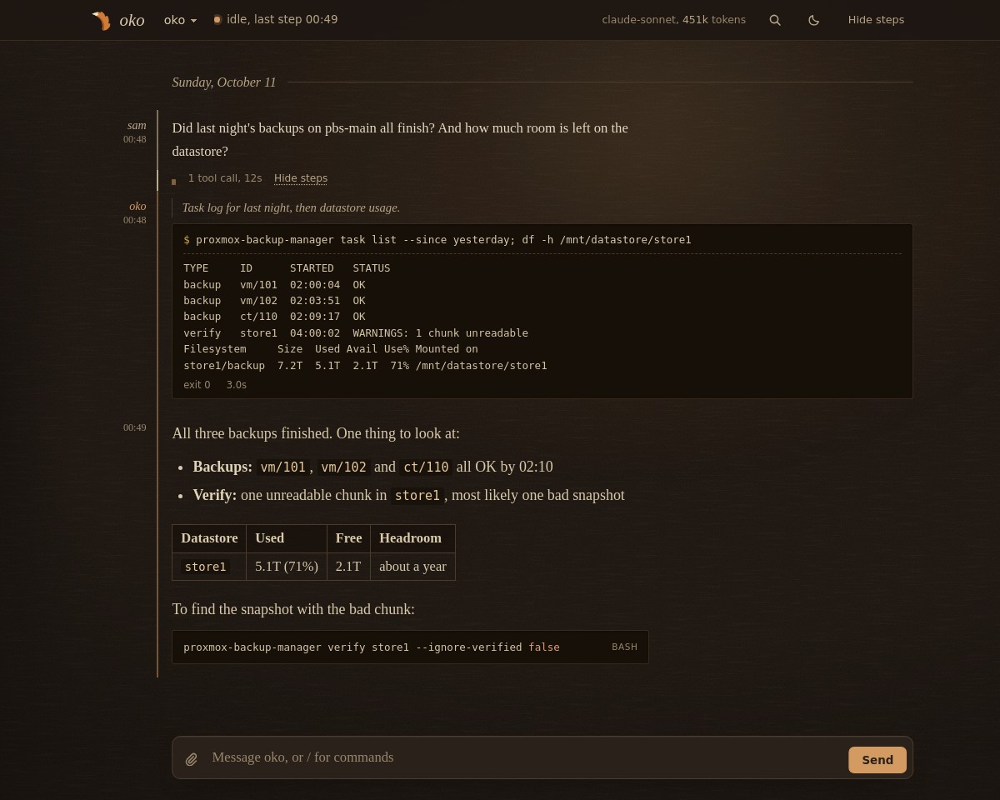
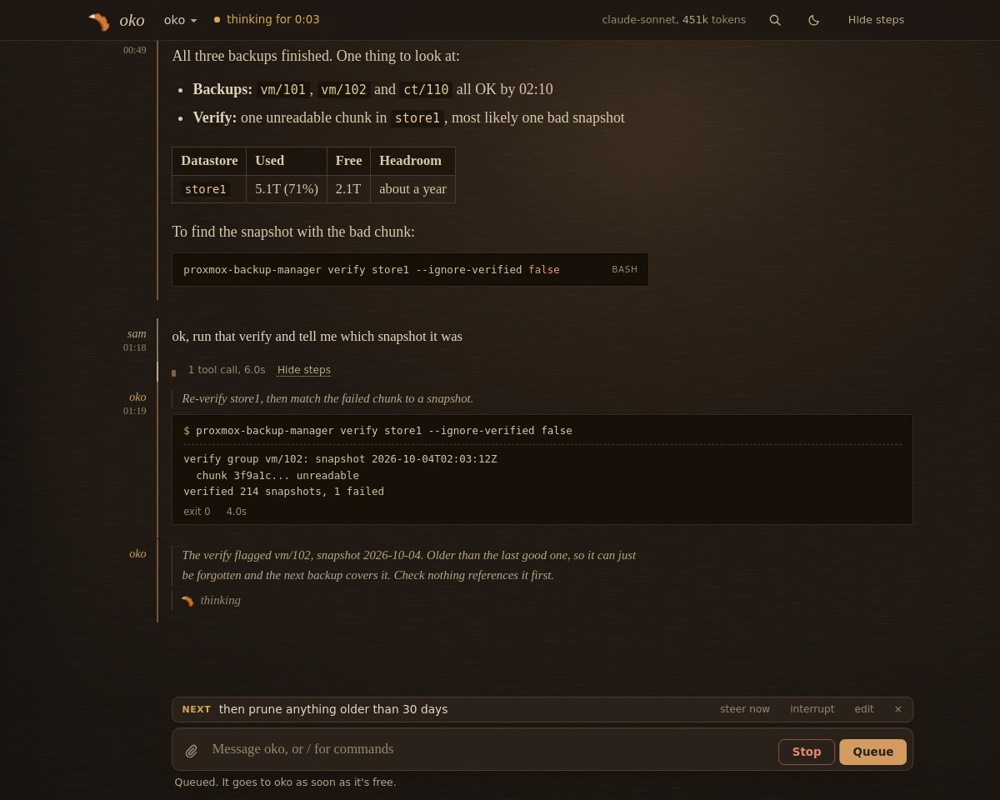
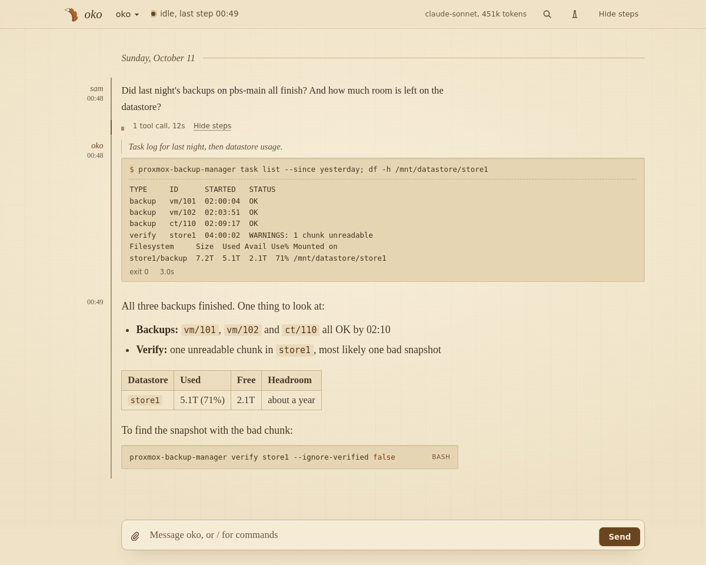
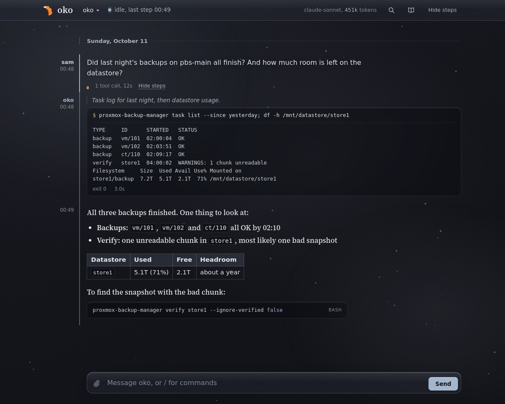
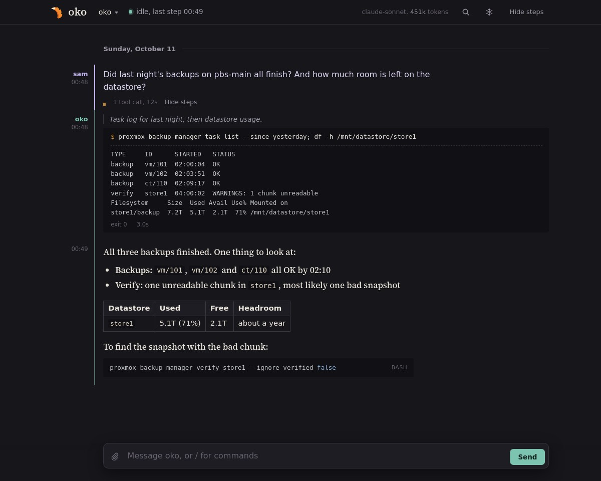

# Features

- **A transcript organized by turn.** Your message, the agent's steps folded underneath, then its
  reply. Tool output renders as a terminal, JSON as tables, and markdown with syntax-highlighted code.
  File edits (`patch`, `write_file`, memory replaces) show as a colored diff with the path and +/− counts.
  Some tools get their own result view, keyed by tool name in a small registry (`RESULTS` in
  `web/app.js`): `web_search` reads as a list of hits (linked title, domain, snippet) and
  `web_extract`/`fetch` as page title, URL and folded text. Only http(s) URLs become links. Output the
  agent wraps in an untrusted-content banner shows a small badge with the banner text on hover. A tool
  without a renderer, or a result shape its renderer doesn't recognize, keeps the generic view. To add
  one, map a tool name to a function that returns `{node, plain, used}`, or `null` to fall back.
  Each turn's tally names its slowest tool call when one dominated.
- **Nothing is lost to trimming.** Long messages, reasoning and tool args are clipped for a readable
  page (`--width`, see [Configuration](configuration.md)), but a clipped one carries a "show full" toggle that swaps the clipped
  rendering for the untruncated text in place, in the same style, no extra request, no second copy
  below it. A clipped queued message gets its full text in a tooltip instead, to keep that one-line
  list compact.
- **Live progress.** Turns sent from the page stream token by token: reasoning, reply text and the
  current tool. Turns started anywhere else (a chat platform, cron, the CLI) appear step by step, with
  a status line showing whether the agent is waiting on the model or running a tool, and with the
  optional [progress plugin](plugins.md#live-progress-for-turns-you-didnt-send) they show thinking and writing
  live too.
- **An activity indicator in the logo.** The fox tail dozes while waiting on the model, sways while
  thinking, wags during tool calls, flicks while writing and curls up while the context compacts.
- **A message queue.** Anything you send while the agent is busy waits above the input box. You can
  edit or remove it, *steer now* to add it to the running turn, or *interrupt* to stop the turn and
  send it immediately. Queued messages survive a reload and go out one at a time.
  The main session's backend queue is also shown; a failed poll keeps its last snapshot marked stale.
  Steers (including typed `/steer`) remain as **application unconfirmed** receipts across Stop, reconnect
  and reload. They are never automatically resent: receipt/queue acknowledgements do not prove application.
  Check the transcript before dismissing a receipt or manually sending again. Image messages cannot steer.
- **Stop any turn.** Stop (or `Esc` `Esc`) uses the agent's own `/stop`, so it works on any turn in
  the main session, wherever it started. Without the [command socket](plugins.md#the-command-socket), it works
  on turns sent from the page.
  **Interrupt** (or `Ctrl`/`Cmd` + `Esc` `Esc`) also works when only the backend reports busy. It requests
  cancellation by run ID, or falls back to the command socket, and reports acknowledgement or failure.
- **A capable input box.** Drafts survive a reload, ↑/↓ recall earlier messages, images can be pasted,
  dropped or attached, and slash commands and skills autocomplete.
- **Scrolling that stays out of your way.** The view follows new steps only while you're at the
  bottom. Scroll up to read and it holds its place, with an "N new steps below" button to jump back.
- **Copy buttons** on replies, reasoning, tool calls and code blocks.
- **Context and usage** (click the usage line, or press `t`): the Context tab shows window occupancy,
  room until auto-compaction, category estimates, expandable context-file details, active messages
  by kind, and the largest messages (click one to jump to it). The Session totals tab holds lifetime
  throughput, cost, model switching, and tool activity over the last week. Refresh reads a new
  snapshot without changing tabs. Close with the close button, Escape, or the background.
  The panel follows every theme, including frost's light and dark variants.
  A `~` and an Estimated label distinguish an estimated context count from last reported prompt usage.
  Hermes can return a transcript estimate without a window limit; no percentage is invented.
  Category and message estimates can differ from reported usage. Loaded context files are already
  part of the system prompt; shortened, skipped and unavailable files are labelled individually.
  Missing or delayed details show a status message; use Refresh after the current turn to try again.
- **What the agent keeps** (the folder button, or press `b`): its memory notes, what it knows about
  you, its skills (open one to read it), cron jobs, and memory or skill writes staged for your
  approval, read straight from `$HERMES_HOME`. With the [command socket](plugins.md#the-command-socket),
  staged writes approve or reject in one click, and when a shell command has been waiting a while
  the input box offers the agent's own `/approve` (once or for the session) and `/deny`. "Always" stays a typed command on purpose.
- **Navigation and notifications.** A session switcher, search across the whole session, compaction
  markers, labels on failed turns, and a desktop notification when a reply lands. The browser tab
  follows along too: the title carries the status line and the icon gets a dot (amber busy, blue
  compacting, green unread reply, gray offline).
- **Four themes**, cycled with `f` and remembered per browser: **shelf at night** (the default),
  **shelf** (tan paper and a Bookerly-style serif, set like an e-reader), **frost** (frosted glass
  with falling snow, light or dark to match your system) and the original dark theme.
- **Keyboard shortcuts** for everything: `j`/`k` between turns, `s` steps, `/` search, `c` compose,
  `f` theme, `t` tokens, `b` memory and skills, `g`/`G` top and latest, `Esc` `Esc` stop, `?` for the full list.
- **Built-in login**, optional: HTTP basic auth or your proxy's forward auth (see [Security](security.md)).
- **Mobile-friendly.**

<table>
  <tr>
    <td width="50%"> Mid-turn: live thinking, Stop, and a queued message</td>
    <td width="50%"> shelf</td>
  </tr>
  <tr>
    <td width="50%"> frost</td>
    <td width="50%"> the original dark theme</td>
  </tr>
</table>
